<div align="center">


# EducaBem

**Doação de livros e educação financeira em uma só plataforma.**
*Quem lê, aprende bem. Quem doa, transforma um futuro.*


[**Landing page**](https://educabem.github.io/EducaBem/) · [**Abrir o app**](https://educabem.github.io/EducaBem/app/#/login)

</div>

<!-- Troque pelo seu GIF de ~20s: login → doar livro → rastreio → trilha → pontos subindo -->
<p align="center">
  
</p>

> [!NOTE]
> Este projeto foi desenvolvido durante o **Transforme-Se (Serasa Experian)**, em parceria com o Instituto PROA. Os pagamentos da tela *Apoiar o EducaBem* ainda não estão ativos.

## Índice

- [Problema e solução](#problema-e-solução)
- [Telas](#telas)
- [Funcionalidades](#funcionalidades)
- [Arquitetura](#arquitetura)
- [Acessibilidade](#acessibilidade)
- [Regras de pontuação e rastreio](#regras-de-pontuação-e-rastreio)
- [Como rodar](#como-rodar)
- [Banco de dados (Supabase)](#banco-de-dados-supabase)
- [Chatbot](#chatbot)
- [Publicação](#publicação)
- [Estrutura do repositório](#estrutura-do-repositório)
- [Decisões técnicas e limitações](#decisões-técnicas-e-limitações)
- [Equipe](#equipe)

## Problema e solução

**Problema.** Muitos livros ficam parados em casa enquanto bibliotecas e ONGs precisam deles, e a educação financeira ainda chega a poucas pessoas. Quem quer doar esbarra em frete, em burocracia e na falta de retorno sobre o destino do livro.

**Solução.** Uma plataforma que junta as duas pontas:

1. a pessoa cadastra o livro e escolhe um ponto parceiro para entregar pessoalmente, **sem frete e sem intermediário**;
2. a doação é acompanhada em três etapas, com notificação a cada mudança;
3. enquanto isso, trilhas curtas ensinam educação financeira com vídeo, resumo, atividade e quiz;
4. doar e estudar rendem pontos, que viram níveis, medalhas e posição no ranking.

O projeto é alinhado à missão da Serasa de promover a educação financeira e trabalha os **ODS 1** (Erradicação da Pobreza), **4** (Educação de Qualidade), **10** (Redução das Desigualdades) e **12** (Consumo e Produção Responsáveis).

## Telas

### Fluxo principal

| 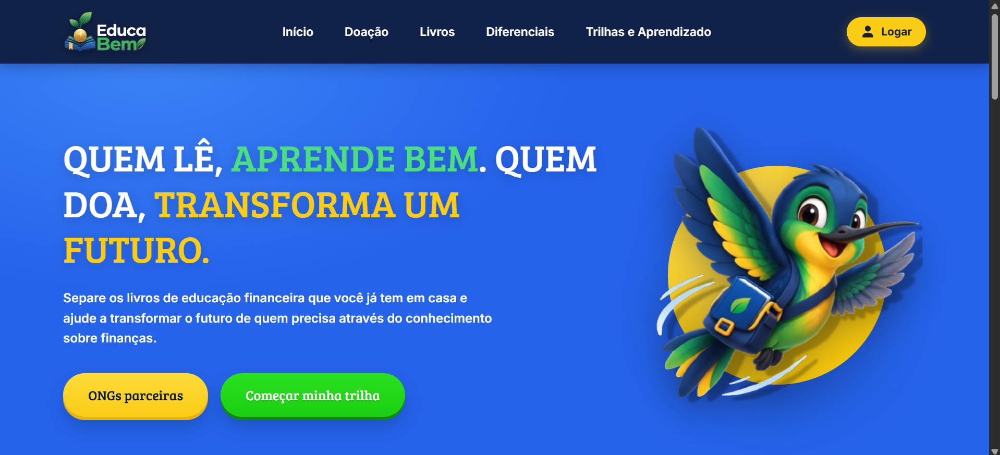 |  |
|:--:|:--:|
| **Landing page** — apresenta a proposta, como funciona a doação e os diferenciais | **Login** — autenticação real pelo Supabase Auth |
| 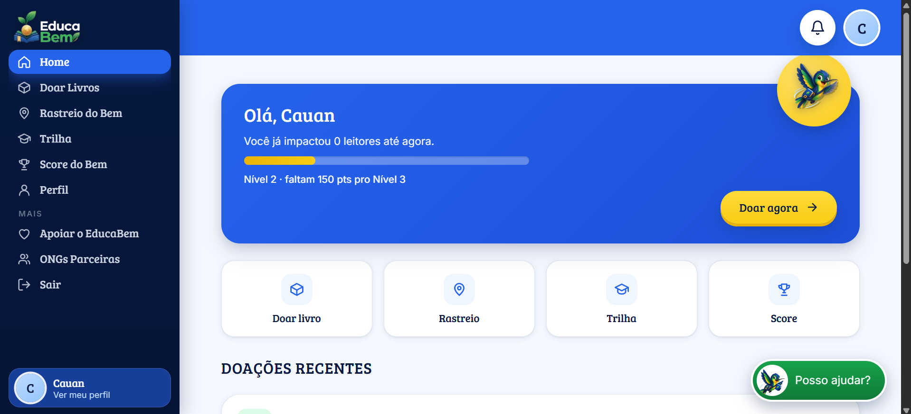 | 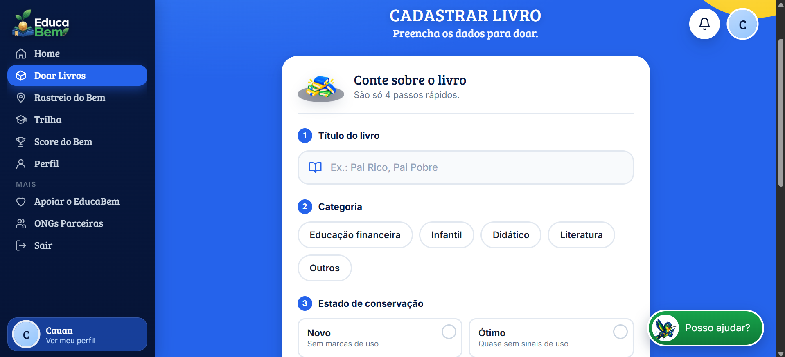 |
| **Home** — nível, progresso e doações recentes | **Doar livro** — 4 passos: título, categoria, estado e ponto de entrega |
| 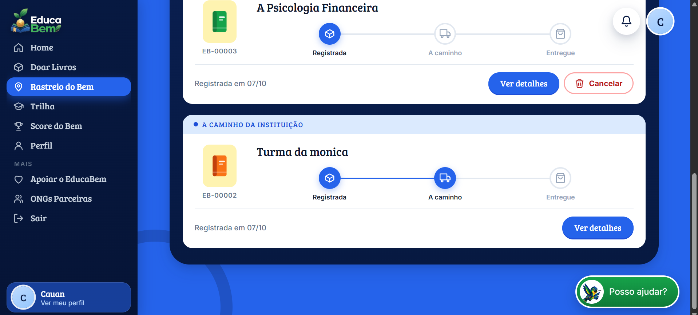 | 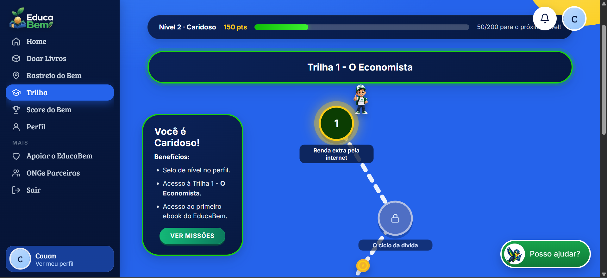 |
| **Rastreio do Bem** — linha do tempo em 3 etapas, com cancelamento | **Trilha** — mapa de módulos que se liberam conforme o progresso |
| 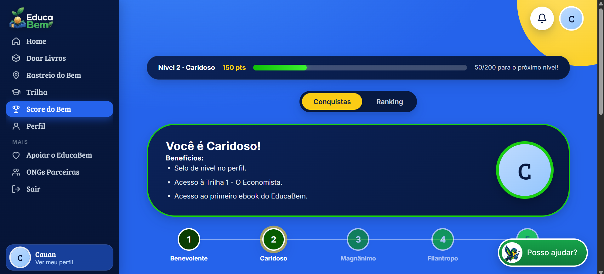 | 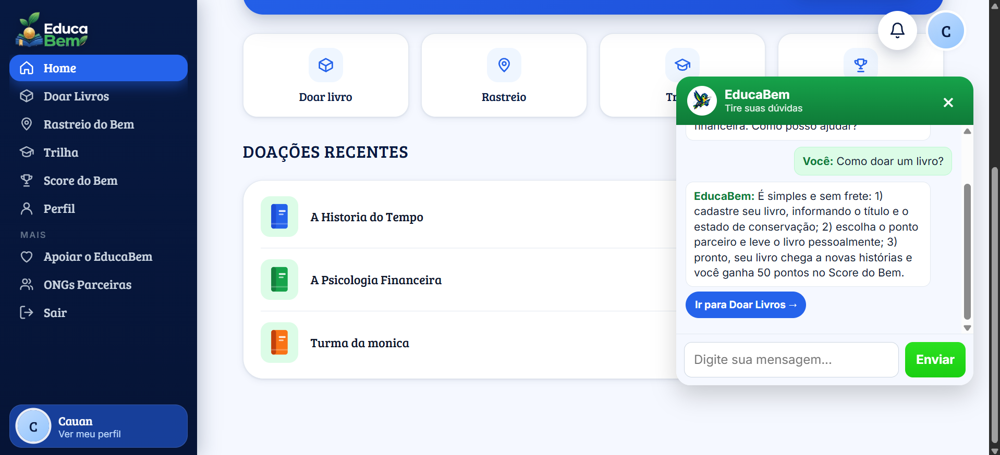 |
| **Score do Bem** — níveis, medalhas e conquistas | **Bem, o chatbot** — responde e leva direto à tela certa |

### Versão mobile

O app é responsivo: no celular o menu lateral vira um menu hambúrguer e os cartões se reorganizam em coluna.

| 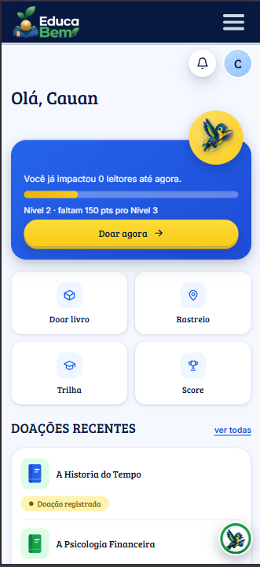 | 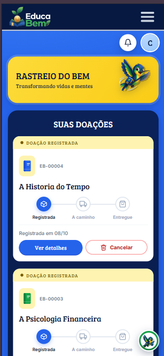 | 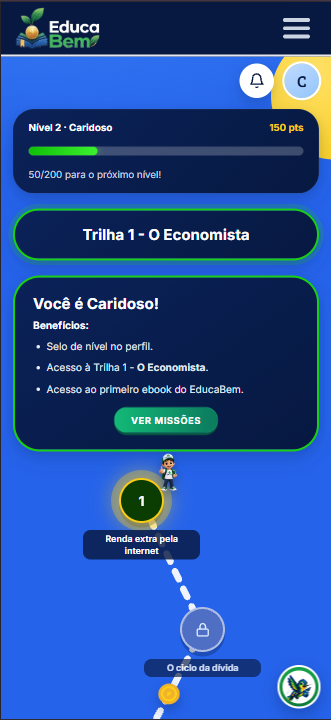 |
|:--:|:--:|:--:|
| **Home** | **Rastreio** | **Trilha** |

<details>
<summary><b>Ver todas as telas</b></summary>

<br>

| 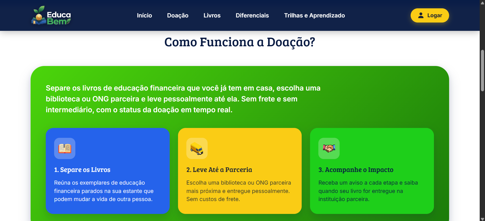 | 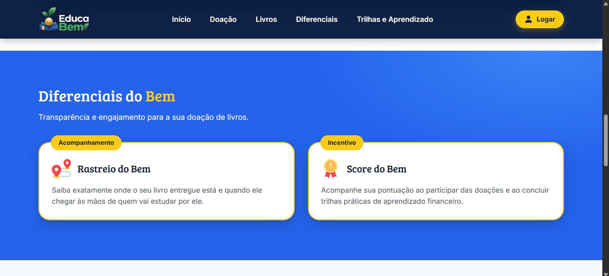 |
|:--:|:--:|
| **Landing: como funciona a doação** | **Landing: diferenciais** |
|  |  |
| **Landing: carrossel de livros recomendados** | **Módulo com vídeo, resumo, atividade e quiz** |
| 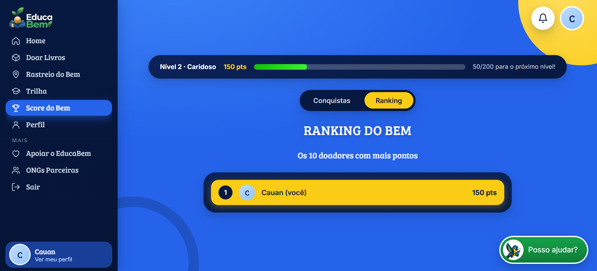 | 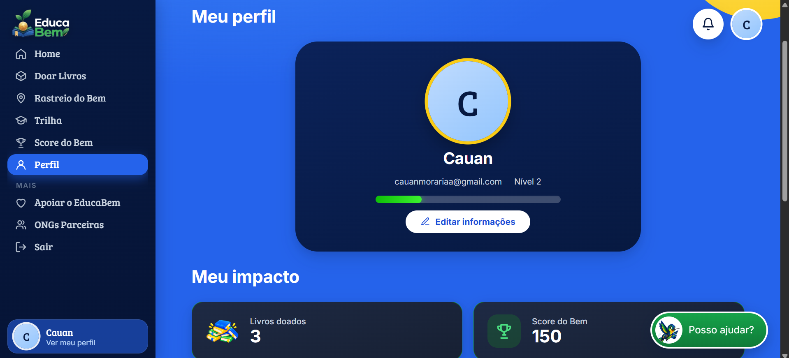 |
| **Ranking do Bem** — top 10 doadores | **Perfil** — dados, impacto e aprendizagem |
|  | 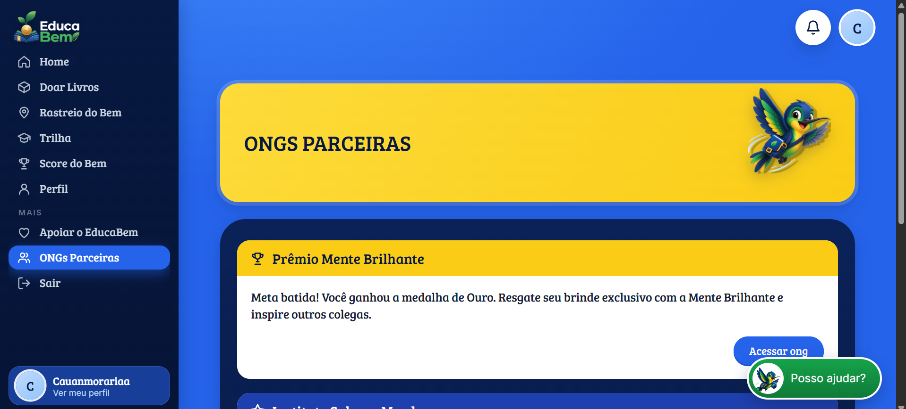 |
| **Apoiar o EducaBem** — planos e doação única (pagamentos em breve) | **ONGs parceiras** |

</details>

## Funcionalidades

| Recurso | Descrição |
|---|---|
| **Doar Livros** | Cadastro do livro (título, categoria e estado de conservação) e escolha do ponto parceiro. |
| **Rastreio do Bem** | Linha do tempo da doação, histórico, notificações e cancelamento. |
| **Trilha** | Cinco módulos de educação financeira, cada um com vídeo, cartões de resumo, atividade e quiz. |
| **Score do Bem** | Pontos, níveis, medalhas e ranking. A troca por recompensas está em breve. |
| **Bem, o chatbot** | Assistente que tira dúvidas e leva direto à tela certa. Veja [Chatbot](#chatbot). |
| **ONGs Parceiras** | Instituições que recebem os livros e dão baixa na entrega. |
| **Apoiar o EducaBem** | Plano mensal ou doação única via Pix ou cartão (**pagamentos em breve**). |
| **Perfil** | Dados da conta: nome, nascimento e foto. |

**Módulos da trilha:** Renda extra pela internet · O ciclo da dívida · Atrasada, negativada ou caducada? · O que é amortização? · Juros de mora.

## Arquitetura

O repositório entrega **dois produtos em um único build**: uma landing page estática (HTML, CSS e JavaScript puro) e um web app React. Os dois saem do mesmo Vite, com duas entradas.

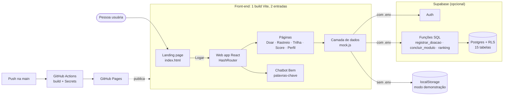

### Stack

| Camada | Tecnologia |
|---|---|
| Interface | React 18 e React Router 6 (rotas com `#`, ex.: `/app/#/home`) |
| Build | Vite 5, com duas entradas: landing e app |
| Banco e autenticação | Supabase (Auth, Postgres, RLS e funções SQL), opcional |
| Vídeos da trilha | YouTube, com player próprio e link alternativo |
| Chatbot | Respostas por palavras-chave, sem serviço externo |
| Deploy | GitHub Actions e GitHub Pages |

### Camada de dados com dois modos

Toda a leitura e escrita passa por `app/src/mock.js`, que expõe a **mesma interface** para as telas e decide a origem dos dados:

- **Com `.env`** (`temBanco = true`): cadastro, login, perfil, doações, rastreio, notificações, trilha, pontos e ranking vêm do Supabase.
- **Sem `.env`** (modo demonstração): tudo roda no `localStorage`, então qualquer pessoa testa o app sem criar banco.

As telas não sabem de onde vêm os dados, o que mantém a interface desacoplada do backend.

### Modelo de dados

O Postgres tem **15 tabelas**. Algumas decisões de modelagem:

- **Livro-razão de pontos.** Cada ponto ganho é uma linha em `pontos_lancamentos` (origem, referência e valor), e um *trigger* (`somar_pontos`) mantém o total em `usuarios.pontos_totais`. Dá para auditar de onde veio cada ponto e desfazer os de uma doação cancelada.
- **Histórico de eventos.** `doacao_eventos` guarda cada mudança de status, e é ela que alimenta a linha do tempo do Rastreio.
- **Conteúdo da trilha em tabelas.** `trilhas`, `modulos`, `modulo_cartoes`, `perguntas_quiz` e `alternativas` são gerados a partir de `conteudo.js` por um script (`banco/gerar-seed-trilha.mjs`).
- **Cadastro automático.** Um *trigger* (`criar_usuario_ao_cadastrar`) cria o perfil assim que a conta é criada no Supabase Auth.

**Diagrama entidade-relacionamento**

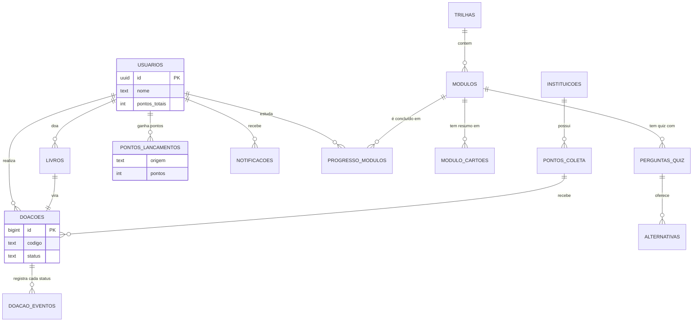

A tabela `niveis` é só de consulta (faixas de pontos de cada nível) e não se liga às demais.

### Segurança

A segurança fica no banco, e não no front-end:

- **RLS** ativado, com políticas `... _ver_proprio` e `... _ver_proprias`: cada pessoa só enxerga os próprios livros, doações, pontos, progresso e notificações.
- **Privilégio mínimo.** O script começa com `revoke all` em todas as tabelas e funções para `anon` e `authenticated`, e só depois concede o estritamente necessário.
- **Permissão por coluna.** O cliente só pode atualizar `nome`, `data_nascimento` e `avatar_url`. O `pontos_totais` fica de fora de propósito, então ninguém altera a própria pontuação pela API.
- **Regras de negócio em funções SQL** (`registrar_doacao`, `concluir_modulo`, `ranking`), todas com `security definer` e `search_path` fixo, validando `auth.uid()` dentro da função.
- **Ação restrita da instituição.** `mudar_status_doacao` **não tem permissão para usuários logados**: só roda pelo SQL Editor (`service_role`). Um doador não consegue marcar a própria doação como entregue.
- Apenas a chave **publicável** vai para o front-end. A `SECRET_KEY` nunca entra no código, no `.env` ou no GitHub.

### Ciclo de uma doação

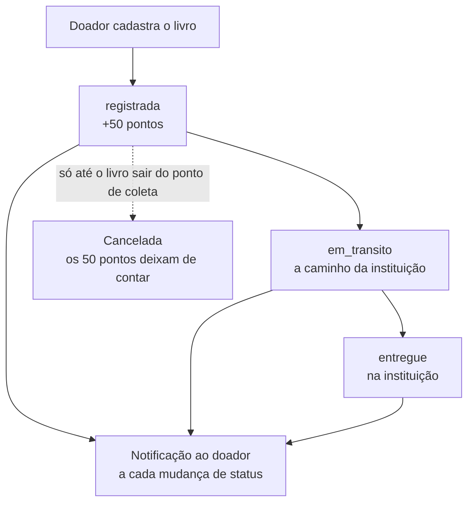

Quem muda o status é a instituição (hoje via SQL Editor); o doador só pode cancelar.

## Acessibilidade

A acessibilidade foi tratada junto com o código, na landing e no app, e não como ajuste final.

**Navegação por teclado e foco**
- Link **"Pular para o conteúdo"** na landing e no app, visível apenas ao receber foco.
- Indicador de foco visível em todos os controles (contorno amarelo de 3 px com contraste sobre o fundo azul).
- Menu hambúrguer com `aria-expanded` e `aria-controls`; a página atual na navegação é marcada com `aria-current`.

**Movimento e animação**
- Respeito a `prefers-reduced-motion`: animações e transições são desativadas para quem pede menos movimento.
- O carrossel de livros da landing tem botão **"Pausar movimento / Retomar movimento"** e pode ser navegado pelas setas.

**Leitores de tela**
- Documento em `lang="pt-BR"` e títulos `h1` ocultos visualmente (`sr-only`) nas telas Score e Trilha, para manter a hierarquia.
- Modais (missões da trilha, cancelar doação) com `role="dialog"` ou `role="alertdialog"`, `aria-modal` e rótulos associados.
- Sino de notificações com rótulo que informa a quantidade de novas; botões de ícone com `aria-label`.
- Chatbot com `role="log"` e `aria-live="polite"`, e aviso "EducaBem está digitando" só para leitores de tela.
- Opções de quiz, valores e seleções com `aria-pressed`, e mensagens de erro de formulário com `role="alert"`.

**Conteúdo**
- Vídeos da trilha com **alternativa em texto** (resumo) e link "Não carregou? Assistir no YouTube".
- Texto em português simples, com explicações curtas, para quem está começando em finanças.

> [!NOTE]
> Esses recursos foram implementados seguindo boas práticas do WCAG 2.2, mas **ainda não passaram por uma auditoria formal** (Lighthouse, axe ou teste com leitor de tela). Está no roadmap.

## Regras de pontuação e rastreio

**Pontos**

| Ação | Pontos |
|---|---|
| Registrar uma doação | 50 |
| Concluir um módulo da trilha | 10 |
| Concluir a trilha completa | 50 |

**Níveis**

| Nível | Nome | A partir de |
|---|---|---|
| 1 | Benevolente | 0 pontos |
| 2 | Caridoso | 100 pontos |
| 3 | Magnânimo | 300 pontos |
| 4 | Filantropo | 600 pontos |
| 5 | nome a definir | 1000 pontos |

**Medalhas** (da inicial até a de ouro)

| Família | Como conquistar |
|---|---|
| Coração Benigno | Doar 1 vez (inicial), 5 (bronze), 10 (prata) e 50 (ouro) |
| Viajante Bonificador | Completar as Trilhas 1 (inicial), 2 (bronze), 3 (prata) e 4 (ouro) |

**Status da doação**

| Status | Texto no app |
|---|---|
| `registrada` | Doação registrada |
| `em_transito` | A caminho da instituição |
| `entregue` | Entregue na instituição |

## Como rodar

Requer **Node 18+**.

```bash
git clone https://github.com/EducaBem/EducaBem.git
cd EducaBem
npm install
npm run dev        # http://localhost:5173/  (landing)  ·  /app/#/login  (app)
```

Outros comandos:

```bash
npm run build      # gera ./dist
npm run preview    # testa o build
```

Para abrir no celular, na mesma rede Wi-Fi: `npm run dev -- --host` e use o endereço *Network*.

### Modo de demonstração

Sem configurar nada, o app roda em modo de demonstração (dados no navegador). Abra `http://localhost:5173/app/#/login`. Conta nova começa zerada; entre com `maria.alves@email.com` para ver a conta de exemplo, com doações, pontos e progresso na trilha.

> [!WARNING]
> No modo de demonstração o login **não valida senha**. Ele serve só para testar a interface; o site publicado deve rodar com o Supabase configurado (veja [Publicação](#publicação)).

### Variáveis de ambiente

Copie `.env.example` para `.env`. **Nunca versione o `.env`**, só o `.env.example`. Sem estas duas variáveis, o app abre em modo de demonstração.

| Variável | Descrição |
|---|---|
| `VITE_SUPABASE_URL` | URL do projeto no Supabase, ex.: `https://SEU-PROJETO.supabase.co` |
| `VITE_SUPABASE_PUBLISHABLE_KEY` | Chave publicável (`sb_publishable_...`), em *Project Settings → API Keys* |

O nome precisa começar com `VITE_`, senão o Vite não entrega a variável ao app.

> [!WARNING]
> Nunca coloque a `SECRET_KEY` no código, no `.env` ou no GitHub.

## Banco de dados (Supabase)

1. Crie um projeto no [Supabase](https://supabase.com) e rode os arquivos de `banco/` no **SQL Editor**, nesta ordem, um de cada vez:
   1. `01_schema.sql`: tabelas, regras de segurança (RLS), *triggers* do cadastro e funções
   2. `02_seed_base.sql`: níveis, instituição e pontos de coleta
   3. `03_seed_trilha.sql`: módulos, cartões e perguntas da trilha
   4. `04_cancelar_doacao.sql`: função de cancelar doação
2. Em **Authentication → Sign In / Providers → Email**, desligue **Confirm email** (o cadastro entra direto no app).
3. Preencha o `.env` com as duas variáveis acima.

### Status da integração

| Já usa o banco | Ainda não usa |
|---|---|
| Cadastro e login | Foto de perfil (fica só no aparelho) |
| Perfil (nome e nascimento) | Recuperação de senha (a tela avisa que está em construção) |
| Doações, rastreio e cancelamento | Login com Google (o botão fica oculto com o banco ligado) |
| Notificações | Apoiar o EducaBem (pagamentos fora do escopo atual) |
| Trilha (progresso e estrelas) | |
| Pontos e ranking | |

### Simular o andamento de uma doação

Quem muda o status é a instituição. Por enquanto isso é feito no SQL Editor:

```sql
select mudar_status_doacao(id, 'em_transito') from doacoes order by id desc limit 1;
select mudar_status_doacao(id, 'entregue')    from doacoes order by id desc limit 1;
```

No app, o novo status aparece ao trocar de tela. A notificação chega junto.

## Chatbot

O **Bem**, beija-flor mascote do projeto, aparece como botão flutuante em todas as telas do app depois do login. Ele reconhece palavras-chave na pergunta e responde com textos escritos pela equipe, quase sempre com um botão que abre a tela correspondente (Doar, Rastreio, Trilha, Score, ONGs, Apoiar, Perfil).

Para editar ou ampliar as respostas, mexa em um único arquivo: `app/src/components/Chatbot/chatbotResponses.js`.

```js
{
  termos: ['rastreio', 'acompanhar', 'foi entregue'],   // palavras-chave, sem acento
  texto: 'No Rastreio do Bem você acompanha cada doação em 3 etapas...',
  link: { to: '/rastreio', rotulo: 'Abrir Rastreio do Bem' }   // opcional
}
```

- Um termo comum só casa **palavra inteira**. Terminado em `*`, casa o começo da palavra (`doac*` casa "doação" e "doações").
- Se duas respostas casam, vence a que tiver os termos mais específicos (mais longos).
- A mensagem inicial, as sugestões e a resposta padrão ficam no topo do mesmo arquivo.

> [!NOTE]
> Pontos, níveis e etapas citados nas respostas espelham `PTS`, `NIVEIS` e `STATUS` em `app/src/mock.js`. Se mudar as regras lá, atualize as respostas também.

## Publicação

O deploy roda pelo **GitHub Actions** (`.github/workflows/deploy.yml`) a cada push na `main`.

Para o site publicado se conectar ao banco, crie em **Settings → Secrets and variables → Actions → Repository secrets** os secrets `VITE_SUPABASE_URL` e `VITE_SUPABASE_PUBLISHABLE_KEY`, e rode o workflow de novo. Sem eles, o site publicado abre em modo de demonstração (dá para reconhecer: o botão "Entrar com Google" aparece na tela de login).

**Fluxo de trabalho.** Cada pessoa trabalha na sua branch (ex.: `feature/nome`) e só depois junta na `main`.

> [!IMPORTANT]
> Antes de juntar na `main`, rode `npm run build`. A `main` precisa sempre compilar, senão o deploy falha.

## Estrutura do repositório

```
.
├── index.html, style.css          landing page (o build depende dela: não apague)
├── app/
│   ├── index.html                 entrada do app
│   └── src/
│       ├── pages/                 telas (Home, Doar, Rastreio, Trilha, Score, Perfil...)
│       ├── layouts/               layout do app logado (menu, topo, notificações, chatbot)
│       ├── components/            componentes reutilizáveis
│       │   ├── Chatbot.jsx, Chatbot.css       janela e botão do chatbot
│       │   └── Chatbot/chatbotResponses.js    respostas e palavras-chave
│       ├── app.css                estilos do app
│       ├── supabase.js            conexão com o Supabase (lê o .env)
│       ├── mock.js                camada de dados: modo demonstração + chamadas ao banco
│       └── conteudo.js            conteúdo da trilha (módulos, cartões, quiz, vídeos)
├── banco/                         scripts SQL do Supabase + gerador do seed da trilha
├── scripts/                       utilitários (ex.: buscar IDs de vídeos do YouTube)
├── assets/                        imagens
├── docs/screenshots/              capturas de tela usadas neste README
├── .github/workflows/deploy.yml   deploy no GitHub Pages
└── vite.config.js                 build com 2 entradas: landing + app
```

**Trilha e vídeos.** O conteúdo fica em `app/src/conteudo.js`. Cada módulo tem um campo `video.id` para o ID do vídeo no YouTube; enquanto estiver vazio, a tela mostra "Vídeo em produção" e o resumo em texto. Se mudar os textos ou as perguntas, rode `banco/gerar-seed-trilha.mjs` e execute o novo `03_seed_trilha.sql` no banco.

**Assets.** Use nomes em minúsculas e sem espaços (ex.: `pilha-azul.png`). O GitHub Pages/Linux diferencia maiúsculas de minúsculas, então `Medal.png` ≠ `medal.png`.

## Decisões técnicas e limitações

**Decisões**

- **Modo de demonstração:** sem as variáveis do Supabase, o app roda com dados no `localStorage`. Assim qualquer pessoa testa sem criar banco.
- **Regras no banco:** pontos, cancelamento e ranking são funções SQL com RLS, e não lógica do front-end, para que o cliente não consiga burlá-las.
- **Build com `base: './'`:** o mesmo build funciona em qualquer subpasta, como no GitHub Pages.
- **Rotas com `#`:** o app funciona em hospedagem estática, sem configurar redirecionamento no servidor.
- **Chatbot por palavras-chave:** responde sem depender de serviço externo e as respostas são revisadas pela equipe.
- **Sem confirmação de e-mail por enquanto:** o cadastro entra direto no app, para simplificar o fluxo de testes.

**Limitações conhecidas e próximos passos**

- Os pontos da doação são dados no **registro**, antes da entrega do livro. O ideal é dar só na entrega.
- A instituição ainda não tem tela própria para confirmar o recebimento (hoje, via SQL).
- A confirmação de e-mail está desligada, então o endereço cadastrado não é verificado, e a recuperação de senha ainda não funciona.
- Faltam termos de uso e política de privacidade publicados (o cadastro já registra o aceite).
- O ranking exibe o nome completo dos usuários; vale permitir apelido ou anonimização.
- Pagamentos de *Apoiar o EducaBem*, foto de perfil no servidor e troca de pontos por recompensas ainda não existem.
- O chatbot não entende perguntas fora do que foi cadastrado.
- Não há testes automatizados nem auditoria formal de acessibilidade. Antes de subir, valide com `npm run build` e um teste manual.

## Equipe

Feito com carinho pela equipe EducaBem.

| Pessoa | Papel |
|---|---|
| **Cauan Morária** | Product Owner |
| Eduarda Coelho | Scrum Master |
| Luis Henrique | Desenvolvimento |
| Vitoria | Desenvolvimento |
| Isabelly | Desenvolvimento |
| Thainá Santos | UX |
| Ana Beatriz | UI/UX |
