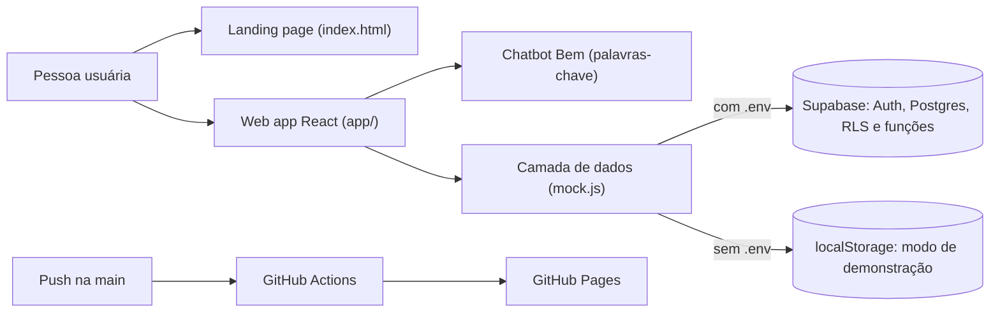
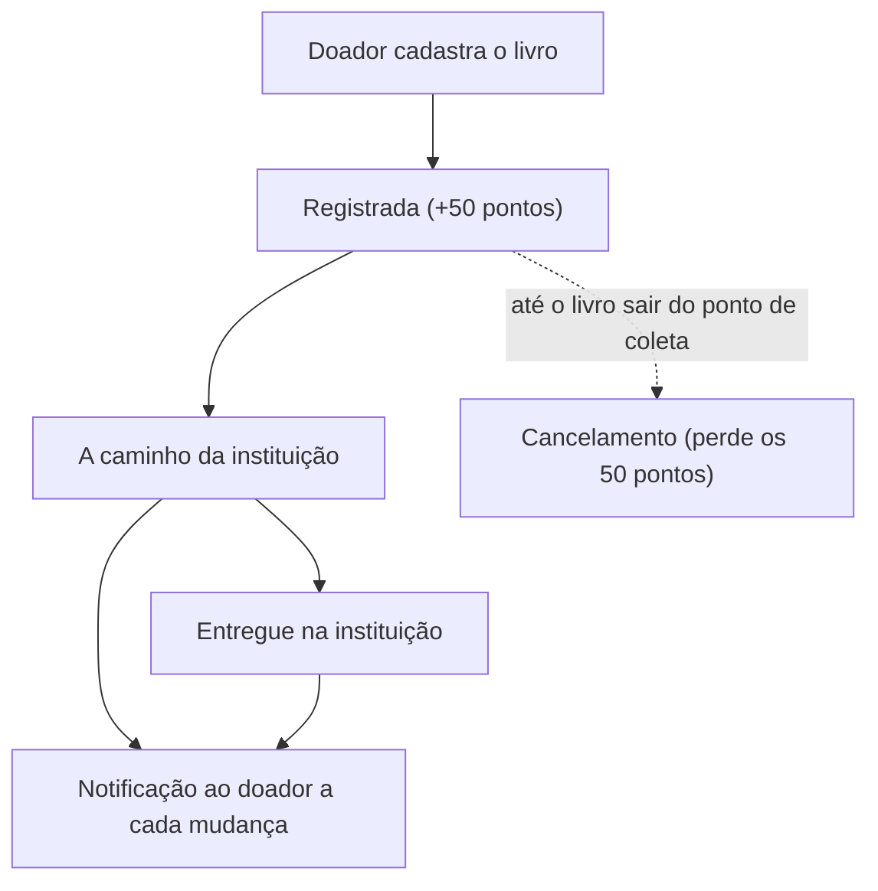

<div align="center">


# EducaBem

**Doação de livros e educação financeira em uma só plataforma**


</div>

> *Quem lê, aprende bem.*

O EducaBem permite doar livros a bibliotecas e ONGs parceiras sem frete e sem intermediário, acompanhar cada doação até a entrega e aprender educação financeira em trilhas interativas. Tudo gera pontos, níveis e medalhas.

O repositório tem uma **landing page** (`index.html`) e um **web app React** (`app/`), no mesmo build Vite. O app funciona de dois jeitos: **conectado ao Supabase** (dados reais) ou em **modo de demonstração** (dados no navegador).

> [!NOTE]
> Os dados do modo de demonstração são fictícios, e os pagamentos da tela *Apoiar o EducaBem* ainda não estão ativos.

## Índice

1. [Problema e solução](#problema-e-solução)
2. [Funcionalidades](#funcionalidades)
3. [Demonstração](#demonstração)
4. [Arquitetura](#arquitetura)
5. [Como rodar](#como-rodar)
6. [Banco de dados (Supabase)](#banco-de-dados-supabase)
7. [Regras de pontuação e rastreio](#regras-de-pontuação-e-rastreio)
8. [Chatbot](#chatbot)
9. [Publicação](#publicação)
10. [Estrutura do repositório](#estrutura-do-repositório)
11. [Decisões técnicas e limitações](#decisões-técnicas-e-limitações)
12. [Equipe](#equipe)

## Problema e solução

**Problema.** Muitos livros ficam parados em casa enquanto bibliotecas e ONGs precisam deles, e a educação financeira ainda chega a poucas pessoas. Quem quer doar esbarra em frete, em burocracia e na falta de retorno sobre o destino do livro.

**Solução.** Uma plataforma que junta as duas pontas:

1. a pessoa cadastra o livro e escolhe um ponto parceiro para entregar pessoalmente;
2. a doação é acompanhada em três etapas, com notificação a cada mudança;
3. enquanto isso, trilhas curtas ensinam educação financeira com vídeo, resumo, atividade e quiz;
4. doar e estudar rendem pontos, que viram níveis, medalhas e posição no ranking.

O projeto é alinhado à missão da Serasa de promover a educação financeira e trabalha os ODS 1 (Erradicação da Pobreza), 4 (Educação de Qualidade), 10 (Redução das Desigualdades) e 12 (Consumo e Produção Responsáveis).

## Funcionalidades

| Recurso | Descrição |
| --- | --- |
| **Doar Livros** | Cadastro do livro (título, categoria e estado de conservação) e escolha do ponto parceiro. |
| **Rastreio do Bem** | Linha do tempo da doação, histórico, notificações e cancelamento. |
| **Trilha** | Cinco módulos de educação financeira, cada um com vídeo, cartões de resumo, atividade e quiz. |
| **Score do Bem** | Pontos, níveis, medalhas e ranking. A troca por recompensas está em breve. |
| **Bem, o chatbot** | Assistente que tira dúvidas e leva direto à tela certa. Veja [Chatbot](#chatbot). |
| **ONGs Parceiras** | Instituições que recebem os livros e dão baixa na entrega. |
| **Apoiar o EducaBem** | Plano mensal ou doação única via Pix ou cartão (pagamentos em breve). |
| **Perfil** | Dados da conta: nome, nascimento e foto. |

**Módulos da trilha:** Renda extra pela internet · O ciclo da dívida · Atrasada, negativada ou caducada? · O que é amortização? · Juros de mora.

## Demonstração

Sem configurar nada, o app roda em modo de demonstração:

```bash
npm install
npm run dev
```

Abra `http://localhost:5173/app/#/login`. Conta nova começa zerada; entre com `maria.alves@email.com` para ver a conta de exemplo, com doações, pontos e progresso na trilha.

- Vídeo de apresentação: _em breve_

## Arquitetura



### Ciclo de uma doação



### Stack

| Componente | Tecnologia |
| --- | --- |
| Interface | React 18 e React Router 6 (rotas com `#`, ex.: `/app/#/home`) |
| Build | Vite 5, com duas entradas: landing e app |
| Banco e autenticação | Supabase (Auth, Postgres, RLS e funções SQL), opcional |
| Vídeos da trilha | YouTube, com player próprio |
| Chatbot | Respostas por palavras-chave, sem serviço externo |
| Deploy | GitHub Actions e GitHub Pages |

## Como rodar

Requer **Node 18+**.

```bash
git clone https://github.com/EducaBem/EducaBem.git
cd EducaBem
npm install
npm run dev        # http://localhost:5173/  (landing)  ·  /app/#/login  (app)
```

Outros comandos:

```bash
npm run build      # gera ./dist
npm run preview    # testa o build
```

Para abrir no celular, na mesma rede Wi-Fi: `npm run dev -- --host` e use o endereço `Network`.

### Variáveis de ambiente

Copie `.env.example` para `.env`. Nunca versione o `.env`, só o `.env.example`. Sem estas duas variáveis, o app abre em modo de demonstração.

| Variável | Descrição |
| --- | --- |
| `VITE_SUPABASE_URL` | URL do projeto no Supabase, ex.: `https://SEU-PROJETO.supabase.co` |
| `VITE_SUPABASE_PUBLISHABLE_KEY` | Chave **publicável** (`sb_publishable_...`), em Project Settings → API Keys |

O nome precisa começar com `VITE_`, senão o Vite não entrega a variável ao app.

> [!WARNING]
> **Nunca** coloque a `SECRET_KEY` no código, no `.env` ou no GitHub.

## Banco de dados (Supabase)

1. Crie um projeto no [Supabase](https://supabase.com) e rode os arquivos de `banco/` no **SQL Editor**, nesta ordem, um de cada vez:
   1. `01_schema.sql`: tabelas, regras de segurança (RLS), trigger do cadastro e funções
   2. `02_seed_base.sql`: níveis, instituição e pontos de coleta
   3. `03_seed_trilha.sql`: módulos, cartões e perguntas da trilha
   4. `04_cancelar_doacao.sql`: função de cancelar doação
2. Em **Authentication → Sign In / Providers → Email**, desligue **Confirm email** (o cadastro entra direto no app).
3. Preencha o `.env` com as duas variáveis acima.

### Status da integração

| Já usa o banco | Ainda não usa |
| --- | --- |
| Cadastro e login | Foto de perfil (fica só no aparelho) |
| Perfil (nome e nascimento) | Recuperação de senha (a tela avisa que está em construção) |
| Doações, rastreio e cancelamento | Login com Google (o botão fica oculto com o banco ligado) |
| Notificações | Apoiar o EducaBem (pagamentos fora do escopo atual) |
| Trilha (progresso e estrelas) | |
| Pontos e ranking | |

### Simular o andamento de uma doação

Quem muda o status é a instituição. Por enquanto isso é feito no SQL Editor:

```sql
select mudar_status_doacao(id, 'em_transito') from doacoes order by id desc limit 1;
select mudar_status_doacao(id, 'entregue')    from doacoes order by id desc limit 1;
```

No app, o novo status aparece ao trocar de tela. A notificação chega junto.

## Regras de pontuação e rastreio

**Pontos**

| Ação | Pontos |
| --- | --- |
| Registrar uma doação | 50 |
| Concluir um módulo da trilha | 10 |
| Concluir a trilha completa | 50 |

**Níveis**

| Nível | Nome | A partir de |
| --- | --- | --- |
| 1 | Benevolente | 0 pontos |
| 2 | Caridoso | 100 pontos |
| 3 | Magnânimo | 300 pontos |
| 4 | Filantropo | 600 pontos |
| 5 | _nome a definir_ | 1000 pontos |

**Medalhas** (da inicial até a de ouro)

| Família | Como conquistar |
| --- | --- |
| Coração Benigno | Doar 1 vez (inicial), 5 (bronze), 10 (prata) e 50 (ouro) |
| Viajante Bonificador | Completar as Trilhas 1 (inicial), 2 (bronze), 3 (prata) e 4 (ouro) |

**Status da doação**

| Status | Texto no app |
| --- | --- |
| `registrada` | Doação registrada |
| `em_transito` | A caminho da instituição |
| `entregue` | Entregue na instituição |

Uma doação só pode ser cancelada enquanto o livro não saiu do ponto de coleta. Ao cancelar, os 50 pontos dela deixam de contar.

## Chatbot

O **Bem**, beija-flor mascote do projeto, aparece como botão flutuante em todas as telas do app depois do login. Ele reconhece **palavras-chave** na pergunta e responde com textos escritos pela equipe, quase sempre com um botão que abre a tela correspondente (Doar, Rastreio, Trilha, Score, ONGs, Apoiar, Perfil).

Para editar ou ampliar as respostas, mexa em um único arquivo: `app/src/components/Chatbot/chatbotResponses.js`.

```js
{
  termos: ['rastreio', 'acompanhar', 'foi entregue'],   // palavras-chave, sem acento
  texto: 'No Rastreio do Bem você acompanha cada doação em 3 etapas...',
  link: { to: '/rastreio', rotulo: 'Abrir Rastreio do Bem' }   // opcional
}
```

- Um termo comum só casa **palavra inteira**. Terminado em `*`, casa o **começo** da palavra (`doac*` casa "doação" e "doações").
- Se duas respostas casam, vence a que tiver os termos **mais específicos** (mais longos).
- A mensagem inicial, as sugestões e a resposta padrão ficam no topo do mesmo arquivo.

> [!NOTE]
> Pontos, níveis e etapas citados nas respostas espelham `PTS`, `NIVEIS` e `STATUS` em `app/src/mock.js`. Se mudar as regras lá, atualize as respostas também.

## Publicação

O deploy roda pelo GitHub Actions (`.github/workflows/deploy.yml`) a cada push na `main`.

Para o site publicado se conectar ao banco, crie em **Settings → Secrets and variables → Actions** os secrets `VITE_SUPABASE_URL` e `VITE_SUPABASE_PUBLISHABLE_KEY`. Sem eles, o site publicado abre em modo de demonstração.

**Fluxo de trabalho.** Cada pessoa trabalha na sua branch (ex.: `feature/nome`) e só depois junta na `main`.

> [!IMPORTANT]
> Antes de juntar na `main`, rode `npm run build`. A `main` precisa sempre compilar, senão o deploy falha.

## Estrutura do repositório

```text
.
├── index.html, style.css          landing page (o build depende dela: não apague)
├── app/
│   ├── index.html                 entrada do app
│   └── src/
│       ├── pages/                 telas (Home, Doar, Rastreio, Trilha, Score, Perfil...)
│       ├── layouts/               layout do app logado (menu, topo, notificações, chatbot)
│       ├── components/            componentes reutilizáveis
│       │   ├── Chatbot.jsx, Chatbot.css       janela e botão do chatbot
│       │   └── Chatbot/chatbotResponses.js    respostas e palavras-chave
│       ├── app.css                estilos do app
│       ├── supabase.js            conexão com o Supabase (lê o .env)
│       ├── mock.js                estado do app: dados de demonstração + chamadas ao banco
│       └── conteudo.js            conteúdo da trilha (módulos, cartões, quiz, vídeos)
├── banco/                         scripts SQL do Supabase + gerador do seed da trilha
├── scripts/                       utilitários (ex.: buscar IDs de vídeos do YouTube)
├── assets/                        imagens
├── .github/workflows/deploy.yml   deploy no GitHub Pages
└── vite.config.js                 build com 2 entradas: landing + app
```

**Trilha e vídeos.** O conteúdo fica em `app/src/conteudo.js`. Cada módulo tem um campo `video.id` para o ID do vídeo no YouTube; enquanto estiver vazio, a tela mostra "Vídeo em produção" e o resumo em texto. Se mudar os textos ou as perguntas, rode `banco/gerar-seed-trilha.mjs` e execute o novo `03_seed_trilha.sql` no banco.

**Assets.** Use nomes em minúsculas e sem espaços (ex.: `pilha-azul.png`). O GitHub Pages/Linux diferencia maiúsculas de minúsculas, então `Medal.png` ≠ `medal.png`.

## Decisões técnicas e limitações

**Decisões**

- **Modo de demonstração:** sem as variáveis do Supabase, o app roda com dados no `localStorage`. Assim qualquer pessoa testa sem criar banco.
- **Build com `base: './'`:** o mesmo build funciona em qualquer subpasta, como no GitHub Pages.
- **Rotas com `#`:** o app funciona em hospedagem estática, sem configurar redirecionamento no servidor.
- **Chatbot por palavras-chave:** responde sem depender de serviço externo e as respostas são revisadas pela equipe.
- **Sem confirmação de e-mail por enquanto:** o cadastro entra direto no app, para simplificar o fluxo de testes.

**Limitações conhecidas**

- Os pontos da doação são dados no registro, antes da entrega do livro. O ideal é dar só na entrega.
- A instituição ainda não tem tela própria para confirmar o recebimento (hoje, via SQL).
- A confirmação de e-mail está desligada, então o endereço cadastrado não é verificado.
- Faltam termos de uso e política de privacidade publicados (o cadastro já registra o aceite).
- O chatbot não entende perguntas fora do que foi cadastrado.
- Não há testes automatizados. Antes de subir, valide com `npm run build` e um teste manual no modo de demonstração.

---

<div align="center">

Feito com carinho pela equipe EducaBem.

</div>